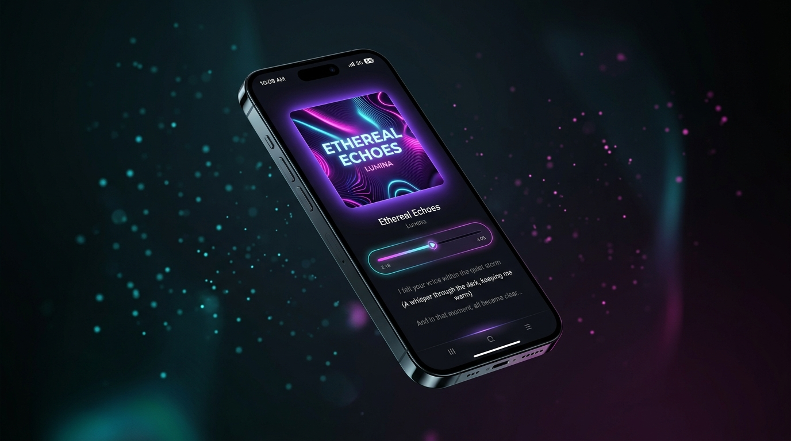

# A1 Swaara (Source Repository)

> **High-Performance Sovereign Audio Streaming & Social Studio engineered by @varshuai.**  
> *Part of the Velorio Labs Ecosystem • Licensed under GNU General Public License v3.0.*

<div align="center">

[](LICENSE)
[](https://github.com/Varshuai/A1Swaara_apk)
[](https://kotlinlang.org)
[](https://developer.android.com/jetpack/compose)
[](https://developer.android.com/media/media3)
[](https://github.com/Varshuai)

<br/>


</div>

---

## Visual Showcase

<div align="center">
  
  
</div>

---

## Overview

**A1 Swaara** is a flagship open-source music streaming application designed for pure audio fidelity, instant offline caching, intelligent multi-language discovery, and interactive social story creation. Engineered from the ground up on modern Android architecture (Jetpack Compose, AndroidX Media3 ExoPlayer, HTTP/3 QUIC, Room Database), A1 Swaara delivers studio-grade acoustics up to **320 kbps (CD-Quality)** without advertisements, trackers, or subscription walls.

```
+------------------------------------------------------------------------+
|                   A1 SWAARA SYSTEM ARCHITECTURE                        |
|                   MAINTAINER: @varshuai (VELORIO LABS)                 |
|                   SECURITY: DETERMINISTIC * ZERO TELEMETRY TRACKING     |
+------------------------------------------------------------------------+
                               |
        +----------------------+----------------------+
        |                      |                      |
        v                      v                      v
+----------------+     +----------------+     +----------------+
|  Presentation  |     |  Audio Core    |     | Backend & Data |
|  Layer         |     |  Engine        |     | Layer          |
|  * Compose M3  |     |  * Media3 Exo  |     |  * Room DB     |
|  * Glassmorphism     |  * 10-Band EQ  |     |  * HTTP/3 QUIC |
|  * Story Studio|     |  * Boom Audio  |     |  * Fast Cache  |
+----------------+     +----------------+     +----------------+
```

---

## Key Features

### 1. Studio-Grade Audio & Playback Engine
* **High-Fidelity Audio Streams**: Unthrottled streaming up to **320 kbps (Ultra HQ)**, **192 kbps (High)**, and **128 kbps (Saver)**.
* **Swaara Boom Audio Engine**: Sub-bass enhancement and 3D acoustic spatialization integrated directly with Android AudioEffect framework.
* **Studio Parametric Equalizer**: 5-band / 10-band audio shaping with bass boost, virtualizer, and customizable frequency presets.
* **Futuristic Animated Loop Engine**: 360-degree rotation animation with dedicated visual aura and high-contrast Repeat-One badge.
* **Seamless Background & Lock Screen Playback**: Full Android MediaSession integration with rich lock screen notifications and sleep timer.

### 2. Modern Obsidian Interface
* **Obsidian Glass Design System**: Deep dark surfaces (`#08080C`, `#111119`), elevated containers (`#191924`), and neon magenta (`#FF2DAA`), violet (`#8B35FF`), and cyan (`#20CFFF`) accents.
* **Hero Album Presentation**: Dynamic artwork presentation with ambient backlight glow, animated placeholder equalizer bars, and swipe navigation.
* **Synchronized Karaoke Lyrics**: Live scrolling timestamped lyrics toggleable with a single tap in the player.
* **Perfect 5-Column Alignment**: Mathematically aligned control deck across both portrait and landscape screen configurations.

### 3. Smart Offline & Downloads Manager
* **Decoupled Playback Caching**: Casual streaming does not bloat disk storage. Only explicitly requested songs are persisted in the Downloads manager.
* **Fast Parallel Downloader**: Multi-chunk downloader writing directly to persistent cache with live progress indicators.
* **Offline Library Hub**: Filter, search, shuffle, and play all offline tracks without internet connectivity.

### 4. Playlist & Cloud Ecosystem
* **Direct Add to Playlist**: Quick-action addition from both Now Playing top bar and contextual Track Options bottom sheet.
* **Dynamic Playlist Creation**: Create and curate custom playlists on the fly.
* **Cloud & Community Sync**: Live crowdsourced Community Charts shelf, background favorite syncing, and lightweight 6-character room codes (`SWxxxx`) for real-time listening together.

### 5. Social Story Creator Studio
* **9:16 Story Card Generator**: Generates vertical Instagram Story and WhatsApp Status cards with frosted backdrop, metadata, and waveforms.
* **Video Music Snippets**: Custom timeline range slider with 30s/60s duration toggle, live audio preview, and direct video export.

---

## Architecture & Module Structure

```
A1Swaara/
├── app/                  # Main Android application module (UI, Service, ViewModel, Navigation)
├── core/
│   ├── data/             # Core Room database, data models, entities, and enums
│   ├── material-compat/  # Material 3 backward compatibility utilities
│   └── ui/               # Base Compose themes, glass components, and styling
├── compose/
│   ├── persist/          # Compose state preservation utilities
│   ├── preferences/      # Persistent preferences delegates
│   ├── reordering/       # Reorderable lists and drag-and-drop mechanics
│   └── routing/          # Type-safe navigation and screen routing
├── providers/
│   ├── common/           # Shared stream extraction contracts
│   ├── youtube-music/    # YouTube Music InnerTube extraction pipeline
│   ├── lrclib/           # Synchronized lyrics provider
│   └── sponsorblock/     # Audio sponsor segment skipping
└── NewPipeExtractor/     # Sovereign upstream extraction engine
```

---

## Tech Stack & Dependencies

| Layer | Component | Description |
| :--- | :--- | :--- |
| **Language** | Kotlin 2.x | Functional programming, Coroutines, StateFlow |
| **UI Framework** | Jetpack Compose + Material 3 | Declarative UI, animated graphics, glassmorphism |
| **Audio Core** | AndroidX Media3 (ExoPlayer) | Audio rendering, session handling, caching |
| **Image Loading** | Coil 3 | High-res album art loading, memory caching |
| **Database** | Android Jetpack Room | Relational database for tracks, playlists, and history |
| **Network Transport** | Ktor Client + HTTP/3 (QUIC) | Multiplexed cloud communication and audio extraction |
| **Storage / Sharing** | Android FileProvider | Secure URI generation for exported stories |
| **Background Processing**| AndroidX WorkManager | Scheduled background update checks |

---

## Building from Source

### Prerequisites
* JDK 17 or higher
* Android SDK (API 34+ / Build Tools 34+)
* Git

### Step-by-Step Build Instructions

1. **Clone the repository with submodules:**
   ```bash
   git clone --recursive https://github.com/Varshuai/A1Swaara.git
   cd A1Swaara
   ```

2. **Build Debug APK:**
   ```bash
   # Windows
   .\gradlew.bat :app:assembleHttp3Debug

   # Linux / macOS
   ./gradlew :app:assembleHttp3Debug
   ```

3. **Build Release APK:**
   ```bash
   # Windows
   .\gradlew.bat :app:assembleHttp3Release

   # Linux / macOS
   ./gradlew :app:assembleHttp3Release
   ```

The compiled release APK will be located at:
`app/build/outputs/apk/http3/release/app-http3-release.apk`

---

## Distribution

The official compiled APKs and release binaries are hosted at:
[https://github.com/Varshuai/A1Swaara_apk](https://github.com/Varshuai/A1Swaara_apk)

---

## Contributing

Contributions are welcome! Please review our [Contributing Guidelines](CONTRIBUTING.md) and [Code of Conduct](CODE_OF_CONDUCT.md) before opening pull requests.

---

## Security

To report security vulnerabilities responsibly, please review our [Security Policy](SECURITY.md).

---

## License

A1 Swaara is released under the **GNU General Public License v3.0 (GPLv3)**. See the [LICENSE](LICENSE) file for complete details.

---

**A1 Swaara** • Engineered by **[@varshuai](https://github.com/Varshuai)** • Part of **[Velorio Labs](https://github.com/VelorioLabs)**
